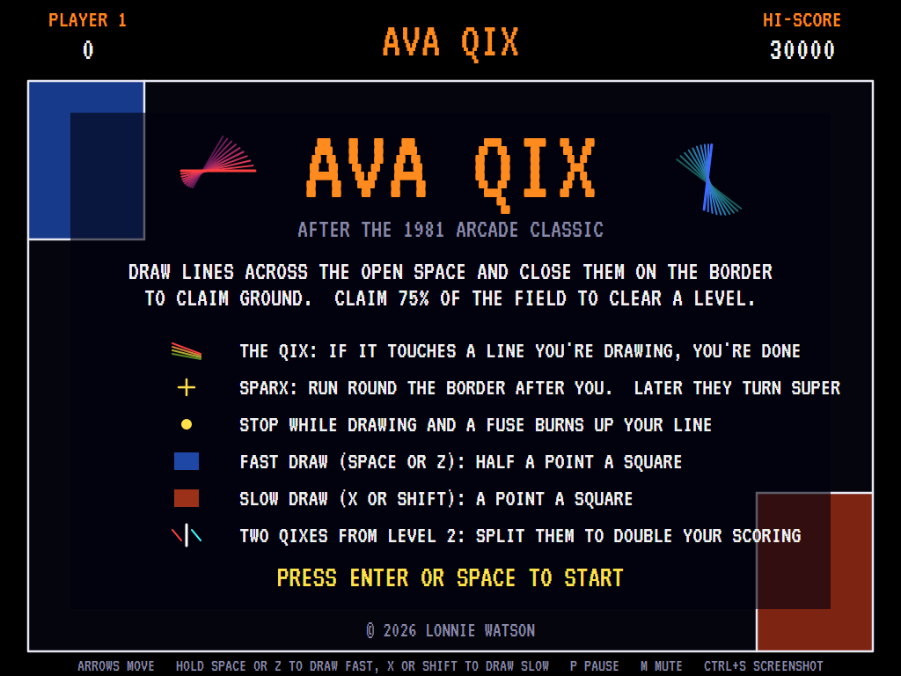
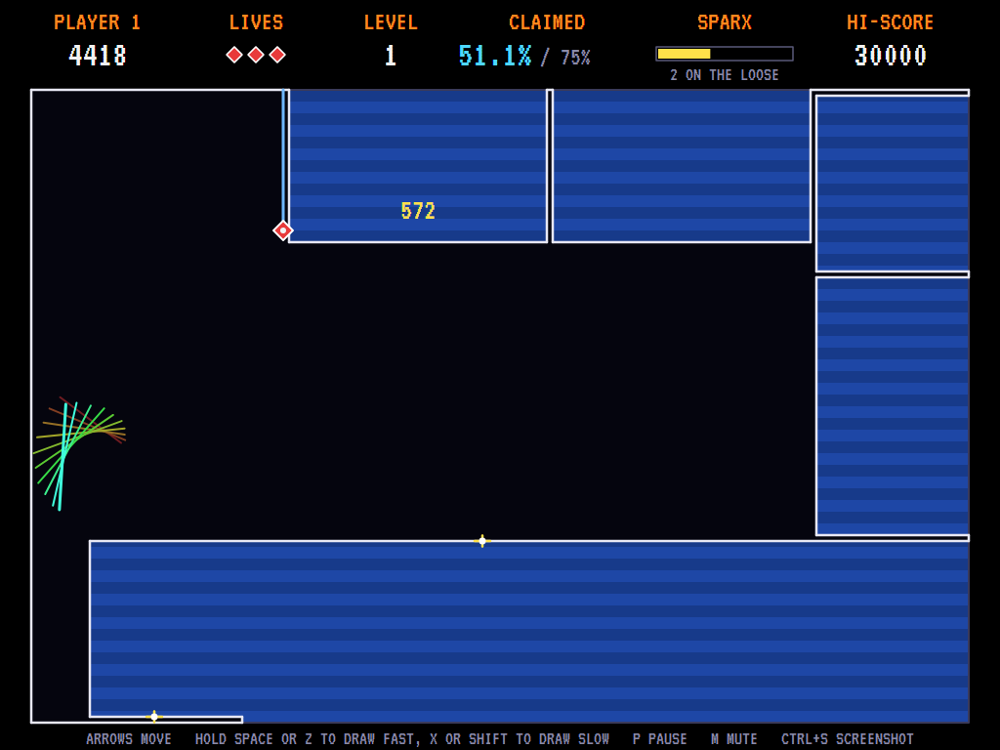
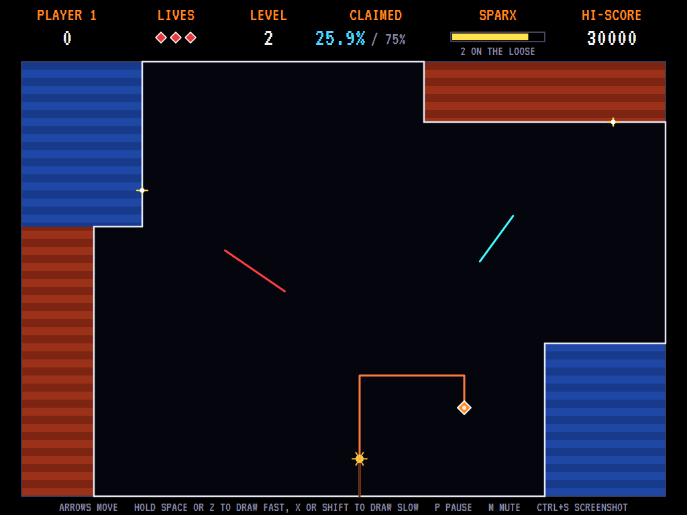
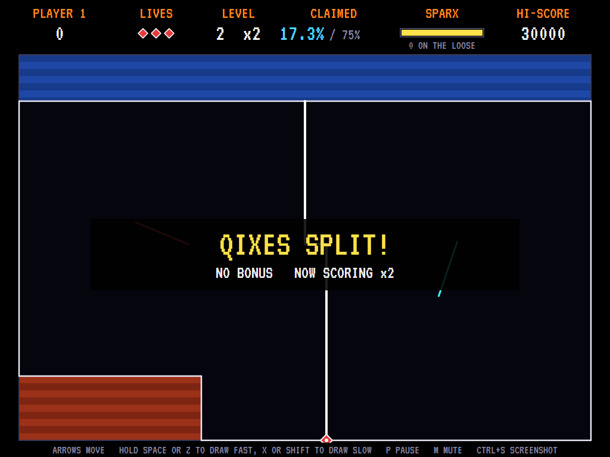
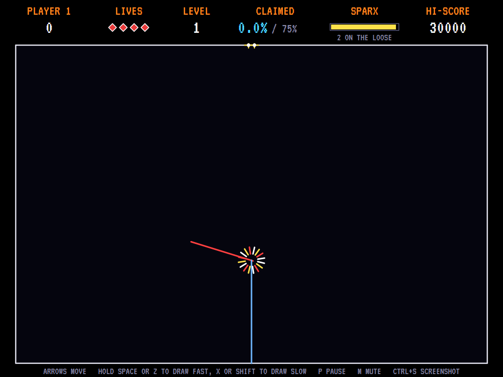
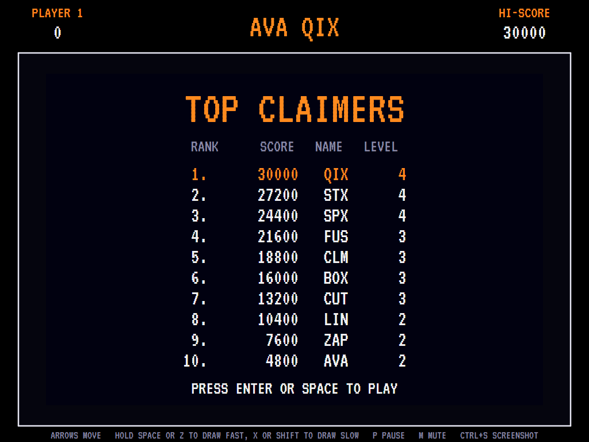

# AVAQix

[](https://github.com/Harlock123/AVAQix/actions/workflows/build.yml)

A territory-claiming game in the style of Taito's 1981 arcade game **Qix**, built with .NET 10 and
Avalonia UI. Draw lines out across the open field and close them back on the border to claim ground.
The qix, a tumbling bundle of lines, roams the open space, and if it touches a line you're still
drawing you lose a life. Claim three quarters of the field to clear the level.

## Features

- **Drawing**: the marker runs round the border. Hold a draw button and it heads out into the open
  space, drawing a line (a *stix*). Bring the line back to the border and every area it cuts off from
  the qix is claimed. A stix can't double back or cross itself.
- **Fast and slow draws**: a fast draw (blue) is worth half a point a square. A slow draw (red) moves
  at half the speed and is worth a point a square. Press fast partway through and the line counts as
  fast.
- **The qix** lurches and spins about the open space, never crossing claimed ground. From level 2
  there are two, and they get quicker and more drawn to your line each level.
- **Sparx** run round the border after you. Out in the open, an ordinary sparx can't reach you. The
  sparx clock at the top counts down: when it runs out two more sparx arrive, and when it runs out
  again they all turn into **super sparx**, which are faster and will chase you up your stix.
- **The fuse**: stop while drawing and a fuse lights where your line began and burns along it towards
  you.
- **Splitting the qixes**: draw a line that leaves the two qixes on different sides and the level ends
  at once, with all your scoring doubled from then on (up to eight times). Clearing a level the
  ordinary way sets it back to one.
- **Bonus**: 1,000 points for every whole percent claimed over 75%.
- **Sound**: the qix's buzzing drone while it moves, plus the drawing ticks, the fuse and the sparx
  alarms. There's also an original title tune and fanfares, all mixed by OpenAL.
- **Attract mode**: leave the title alone for 15 seconds and a computer player plays a demonstration.
  It weighs up boxes to cut off that keep well clear of the qix, turns back from sparx coming its way,
  and ducks out into the open when they close in from both sides. It usually reaches level 3 or 4.
- **Four lives**, a bonus life at 20,000 and every 40,000 after, and a **top-ten high-score table**
  with arcade-style initials entry. The table records the level you reached.
- **Any window size**: the screen scales to fit, letterboxed. **Ctrl+S** saves a screenshot.
- **One self-contained executable** per platform: Windows, macOS and Linux on Intel/AMD and ARM.

## Screenshots

| Title screen | A level under way | Two qixes, a slow draw and a fuse |
|:------------:|:-----------------:|:---------------------------------:|
|  |  |  |
| What's what. | Half the field claimed, a stix on its way down. | Level 2: a slow line stopped, and the fuse burning up it. |

| Splitting the qixes | Caught | The high-score table |
|:-------------------:|:------:|:--------------------:|
|  |  |  |
| One line down the middle: scoring doubles. | The qix found the line. | The best claimers. |

The screenshots are made by the tests, which play the game in a real (headless) window; see
[Tests](#tests).

## Download and run

Ready-to-run builds for Windows, macOS and Linux, on both Intel/AMD and ARM, are on the
[Releases page](https://github.com/Harlock123/AVAQix/releases/tag/latest). **Latest build** is
rebuilt on every push to `main`. Each download is one self-contained executable: no .NET install is
needed.

| Platform | Archive |
|---|---|
| Windows | `AVAQix-win-x64.zip`, `AVAQix-win-x86.zip`, `AVAQix-win-arm64.zip` |
| macOS | `AVAQix-osx-arm64.tar.gz` (Apple silicon), `AVAQix-osx-x64.tar.gz` (Intel) |
| Linux | `AVAQix-linux-x64.tar.gz`, `AVAQix-linux-arm64.tar.gz`, `AVAQix-linux-arm.tar.gz` |

```bash
tar -xzf AVAQix-linux-x64.tar.gz     # or linux-arm64, linux-arm, osx-arm64, osx-x64
./AVAQix
```

On Windows, unzip and run `AVAQix.exe`. On macOS, if Gatekeeper refuses to open it, run
`xattr -d com.apple.quarantine AVAQix` once. Run with `--no-audio` for silence.

**Sound** comes through OpenAL Soft, built in for every platform. In a virtual machine the game
detects it and uses a larger audio buffer, so the sound doesn't break up.

**Gamepads** use SDL2, which is bundled for Windows, macOS and Intel/AMD Linux. ARM Linux builds need it
installed; without it the keyboard still works:

```bash
sudo apt install libsdl2-dev            # Debian / Ubuntu / Raspberry Pi OS
sudo pacman -S --needed sdl2-compat     # Arch / Omarchy
```

## Controls

| Input | Action |
|-------|--------|
| **Arrow keys** / **WASD** / number pad | Move along the border (or out into the open while drawing) |
| **Space** / **Z** / **Ctrl** (hold) | Draw fast |
| **X** / **Shift** (hold) | Draw slow, for double points |
| **Enter** / **Space** | Start a game |
| **P** / **Esc** | Pause (Esc again to quit) |
| **M** | Mute |
| **Ctrl+S** / **Cmd+S** | Save a screenshot to the Pictures folder |

Out in the open the marker only moves while a draw button is held. Let go and it stops, and the fuse
lights.

**Gamepad**: left stick or D-pad to move, **A** to draw fast, **B** or **X** to draw slow; **Start**
or **A** starts, **Start** pauses, **Back** (while paused) quits.

**Entering initials**: type letters, or dial with **Up**/**Down** and accept with **Space**; **Left** /
**Backspace** go back; **Enter** finishes.

## Scoring

| What | Points |
|---|---:|
| Ground claimed with a fast draw | ½ a square |
| Ground claimed with a slow draw | 1 a square |
| Each whole percent over 75% at the end of a level | 1,000 |
| After splitting the qixes | everything ×2, ×4, up to ×8 |

The field is 160 by 108 squares, so 1% is about 173 squares.

## Tests

```bash
dotnet test AVAQix.slnx
```

The engine has no UI and runs in fixed 60 Hz steps, so it plays the same at any frame rate, and a seed
always plays the same game. The tests check:

- the border, open space, and following the border all the way round;
- moving, drawing only with a button held, and stopping when it's let go;
- claiming the side away from the qix, and fast and slow scoring;
- a stix not doubling back or crossing itself, and the fuse;
- the qix touching the stix, and the qix keeping to the open space;
- sparx catching the marker on the border but not out drawing, super sparx chasing up the stix, the
  sparx clock, and sparx put back on the border after a claim;
- clearing a level with its bonus, splitting the qixes and the doubled scoring, and bonus lives;
- the title tune, the demonstration's sound, pausing, and every sound.

A computer player (the attract-mode one) plays whole games in them and must reach level 3.

The screenshot tests draw the real screen in a headless window. To refresh the README's pictures:

```bash
QIX_SHOTS=$PWD/Images dotnet test tests/AVAQix.Tests --filter ScreenshotTests
```

## Building

```bash
dotnet build AVAQix.slnx
dotnet run --project src/AVAQix
```

Needs the .NET 10 SDK. The sounds are made by `tools/make_sounds.py` (standard-library Python):
`python3 tools/make_sounds.py` rewrites `src/AVAQix/Sounds`.

## Project structure

```
AVAQix/
├── AVAQix.slnx
├── src/AVAQix/
│   ├── Engine/
│   │   ├── GameEngine.cs        # States, scoring, bonus lives and the qix's drone
│   │   ├── GameEngine.Play.cs   # The marker, drawing and claiming, the fuse, the qix, the sparx and
│   │   │                        # their clock, and the levels
│   │   ├── Entities.cs          # The marker, the qix, the sparx and the controls
│   │   ├── AttractPilot.cs      # The computer player for the demonstration (and the tests)
│   │   ├── HighScoreTable.cs, InitialsEntry.cs
│   │   ├── InputHandler.cs, ControllerManager.cs  # Keys and an SDL2 gamepad
│   │   └── SoundManager.cs      # Effects, the drone and the tunes through OpenAL
│   ├── Audio/                   # The OpenAL engine (from the author's AVABand)
│   ├── Models/Field.cs          # The playfield grid: borders, following them, and claiming
│   ├── Views/                   # The screen: the field, the qix, sparx, marker, the top strip,
│   │                            # title and tables
│   └── Sounds/                  # The synthesised effects and tunes
├── tests/AVAQix.Tests/          # Gameplay and screenshot tests
├── tools/make_sounds.py
└── Images/                      # Screenshots
```

## About and licence

AVAQix © 2026 Lonnie Watson, under the [MIT License](LICENSE).

*Qix* © 1981 Taito; the name belongs to its current owner. AVAQix is an independent, unofficial game
in its style. Its graphics, sounds, tunes and code are its own; nothing is taken from the arcade
machine's program, graphics or sound. It is not affiliated with or endorsed by any rights holder.

Bundled components keep their own licences: the VT323 font (SIL Open Font License 1.1, by Peter Hull;
`src/AVAQix/Assets/Fonts/VT323-OFL.txt`), OpenAL Soft (LGPL-2.0-or-later; loaded as a separate
library; `src/AVAQix/Audio/native/COPYING-openal-soft.txt`), and the MIT-licensed Avalonia,
Silk.NET, NVorbis, NLayer and SDL2-CS (with SDL2 under the zlib licence).
